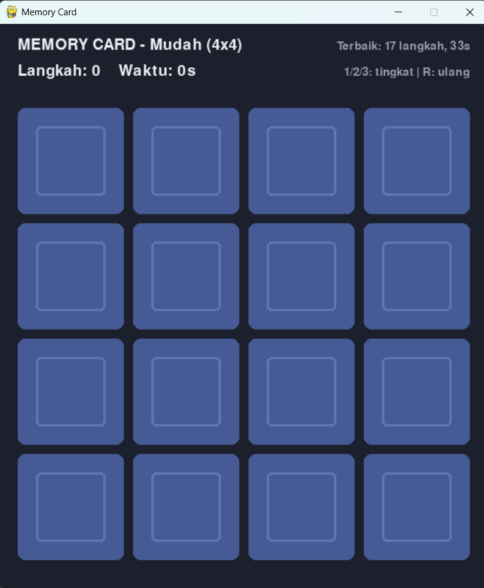

# Memory Card

## Deskripsi Proyek
Memory Card adalah permainan mencocokkan pasangan kartu berbasis GUI yang dibangun menggunakan Pygame dengan pendekatan OOP (Object-Oriented Programming). Pemain membuka dua kartu pada setiap giliran dan berusaha menemukan seluruh pasangan simbol yang sama dengan langkah sesedikit mungkin dan waktu secepat mungkin. Proyek ini menyelesaikan masalah mensimulasikan permainan melatih daya ingat secara visual, lengkap dengan animasi pembalikan kartu, tiga ukuran papan, dan penyimpanan skor terbaik untuk setiap tingkat kesulitan.

## Tampilan Aplikasi

## Fitur Utama
- Tiga tingkat kesulitan: Mudah, Sedang, dan Sulit.
- Simbol kartu berupa kombinasi enam bentuk (lingkaran, persegi, segitiga, belah ketupat, bintang, plus) dan tiga warna, digambar langsung dengan Pygame tanpa file gambar
- Pasangan simbol yang dipakai diacak setiap permainan, sehingga tampilan papan selalu berbeda
- Animasi pembalikan kartu: lebar kartu menyusut lalu melebar kembali saat berganti sisi
- Kartu yang tidak cocok ditampilkan selama jeda singkat lalu ditutup kembali, dan klik selama jeda diabaikan
- Kartu yang cocok tetap terbuka dengan warna latar berbeda
- Penghitung langkah dan waktu, dengan waktu mulai berjalan saat kartu pertama dibuka
- Skor terbaik untuk setiap tingkat kesulitan (langkah paling sedikit, lalu waktu tersingkat) tersimpan di file `skor_terbaik.json`
- Layar kemenangan yang menampilkan hasil dan penanda rekor baru
- Tombol 1, 2, dan 3 untuk berganti tingkat kesulitan, dan R untuk mengulang

## Teknologi yang Digunakan
- Python 3.x
- Pygame
- Modul `random`, `math`, `json`, `os`, dan `sys`

## Arsitektur
Proyek ini dipisah menjadi satu fungsi dan tiga class dengan tanggung jawab yang jelas:
1. **`gambar_simbol()`** adalah fungsi gambar yang menggambar salah satu dari enam bentuk dengan warna tertentu di dalam sebuah area, memakai primitif `pygame.draw` seperti lingkaran, persegi, dan poligon.
2. **`Kartu`** merepresentasikan satu kartu: simbolnya, posisinya, status terbuka atau cocok, dan progres animasi pembalikan (`animasi`, bernilai 0 sampai 1) yang bergerak menuju target setiap frame lewat `perbarui()`.
3. **`PenyimpanSkor`** menangani pembacaan dan penulisan skor terbaik ke file JSON, dengan penanganan jika file belum ada atau rusak. Method `perbarui()` hanya menyimpan skor yang lebih baik dan mengembalikan penanda rekor baru.
4. **`GameMemory`** mengatur seluruh alur permainan. Method `mulai_baru()` memilih simbol, membuat pasangan, mengacaknya, dan menghitung ukuran serta posisi kartu agar grid selalu muat di layar. Method `tangani_klik()` dan `_periksa_pasangan()` menangani giliran pemain, `perbarui()` menutup kembali kartu yang tidak cocok setelah jeda, dan `_gambar_kartu()` menggambar efek pembalikan berdasarkan progres animasi.

Alur permainannya: `main.py` membuat `GameMemory` dan memanggil `jalankan()` → pemain mengklik dua kartu → `_periksa_pasangan()` membandingkan id pasangan, kartu yang cocok dikunci terbuka sedangkan yang tidak cocok dijadwalkan ditutup setelah jeda → saat seluruh pasangan ditemukan, waktu dihentikan dan skor dibandingkan dengan rekor tersimpan.

## Pembelajaran Spesifik
- Membuat animasi pembalikan kartu dari satu nilai progres (0 sampai 1): pada separuh pertama, sisi belakang digambar dengan lebar yang menyusut, lalu pada separuh kedua sisi depan digambar dengan lebar yang melebar, tanpa memerlukan gambar kartu untuk setiap tahap animasi.
- Menjalankan jeda penutupan kartu secara non-blocking dengan menyimpan waktu target (`pygame.time.get_ticks()`) dan memeriksanya setiap frame, alih-alih memakai `time.sleep()` yang akan membekukan seluruh jendela.
- Menghitung ukuran kartu dari ruang yang tersedia dan jumlah baris serta kolom, sehingga tiga ukuran papan yang berbeda otomatis tersusun rapi di tengah layar tanpa pengaturan manual.
- Menyimpan skor terbaik sebagai pasangan (langkah, waktu) dan membandingkannya sebagai tuple, sehingga langkah yang lebih sedikit diutamakan dan waktu hanya menjadi penentu saat langkahnya sama.
- Menggambar simbol langsung dengan primitif Pygame, termasuk bintang dari sepuluh titik poligon yang dihitung dengan fungsi trigonometri, sehingga proyek tidak bergantung pada aset gambar eksternal.
- Menangani kegagalan baca-tulis file skor dengan `try-except`, sehingga permainan tetap berjalan normal meskipun file skor belum ada atau tidak dapat ditulis.
