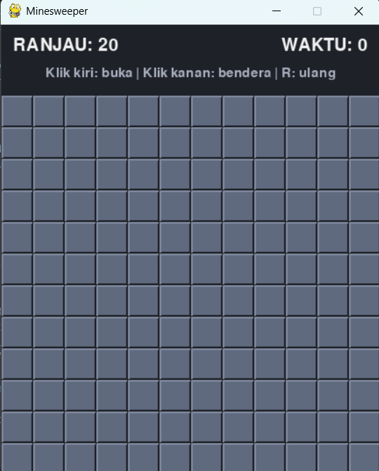

# Minesweeper

## Deskripsi Proyek
Minesweeper adalah replika permainan Minesweeper klasik berbasis GUI yang dibangun menggunakan Pygame dengan pendekatan OOP (Object-Oriented Programming). Pemain membuka sel-sel pada papan 12x12 yang menyembunyikan 20 ranjau, menggunakan angka petunjuk di setiap sel untuk menebak lokasi ranjau, dan memenangkan permainan dengan membuka seluruh sel yang aman. Proyek ini menyelesaikan masalah mensimulasikan permainan logika klasik secara lengkap, termasuk pembukaan area kosong secara berantai, penandaan bendera, pengaman klik pertama, serta penghitung waktu dan sisa ranjau.

## Tampilan Aplikasi

## Fitur Utama
- Papan 12x12 dengan 20 ranjau yang dipasang secara acak
- Klik pertama selalu aman: ranjau baru dipasang setelah klik pertama, dan sel yang diklik beserta tetangganya dijaga bebas ranjau
- Klik kiri untuk membuka sel, klik kanan untuk memasang atau mencabut bendera
- Pembukaan area kosong secara berantai (flood fill) saat sel tanpa ranjau di sekitarnya dibuka
- Fitur chord: klik kiri pada angka yang jumlah benderanya sudah sesuai akan membuka seluruh sel tetangga yang belum ditandai
- Angka petunjuk dengan warna berbeda untuk setiap nilai (1 sampai 8)
- Penghitung sisa ranjau berdasarkan jumlah bendera, dan penghitung waktu yang mulai berjalan saat klik pertama
- Saat kalah, seluruh ranjau ditampilkan dan bendera yang salah ditandai dengan silang kuning
- Saat menang, seluruh ranjau otomatis diberi bendera
- Tombol R untuk memulai permainan baru kapan saja

## Teknologi yang Digunakan
- Python 3.x
- Pygame
- Modul `random`, `collections`, dan `sys`

## Arsitektur
Proyek ini dipisah menjadi tiga class dengan tanggung jawab yang jelas:
1. **`Sel`** menyimpan status satu sel: apakah berisi ranjau, sudah terbuka, diberi bendera, serta jumlah ranjau di sekitarnya.
2. **`Papan`** menangani seluruh logika permainan tanpa bergantung pada tampilan. Method `_pasang_ranjau()` memasang ranjau secara acak di luar zona aman klik pertama lalu menghitung angka petunjuk setiap sel, `buka()` membuka sel dan menjalankan flood fill memakai antrean `deque`, `buka_sekitar()` menangani fitur chord, `toggle_bendera()` mengatur bendera, dan `menang()` memeriksa apakah seluruh sel aman sudah terbuka.
3. **`GameMinesweeper`** mengatur tampilan dan input. Method `tangani_klik()` menerjemahkan posisi mouse menjadi koordinat sel dan memanggil `Papan`, `_proses_hasil()` memperbarui status permainan (siap, main, menang, kalah), serta method `_gambar_*` menggambar header, sel, bendera, dan ranjau langsung dengan primitif Pygame tanpa file gambar eksternal.

Alur permainannya: `main.py` membuat `GameMinesweeper` dan memanggil `jalankan()` → pada setiap frame, event mouse dan keyboard diproses oleh `tangani_event()` → klik kiri pertama memasang ranjau dan memulai timer → setiap pembukaan sel mengembalikan hasil ("ok", "ranjau", atau "abaikan") yang menentukan apakah permainan berlanjut, dimenangkan, atau kalah → `gambar()` menggambar ulang seluruh layar.

## Pembelajaran Spesifik
- Menunda pemasangan ranjau hingga klik pertama agar pemain tidak pernah kalah pada langkah pertama, sekaligus menjaga area di sekitar klik tetap bebas ranjau agar pembukaan awal selalu berarti.
- Menerapkan flood fill secara iteratif dengan antrean (`deque`) alih-alih rekursi, sehingga pembukaan area kosong yang luas tidak berisiko menyebabkan batas kedalaman rekursi terlampaui.
- Memisahkan logika papan (`Papan`) dari tampilan (`GameMinesweeper`), sehingga aturan permainan dapat diuji secara independen tanpa menjalankan jendela Pygame.
- Menghitung angka petunjuk sekali saja saat ranjau dipasang dan menyimpannya pada setiap sel, bukan menghitung ulang setiap kali sel digambar.
- Membedakan klik kiri dan kanan lewat `event.button` pada `MOUSEBUTTONDOWN`, serta menerjemahkan koordinat piksel menjadi indeks baris dan kolom dengan pembagian bilangan bulat terhadap ukuran sel.
- Menggambar seluruh elemen (bendera, ranjau, angka) secara langsung dengan `pygame.draw` tanpa aset gambar, sehingga proyek tetap ringkas dan tidak bergantung pada file eksternal.
