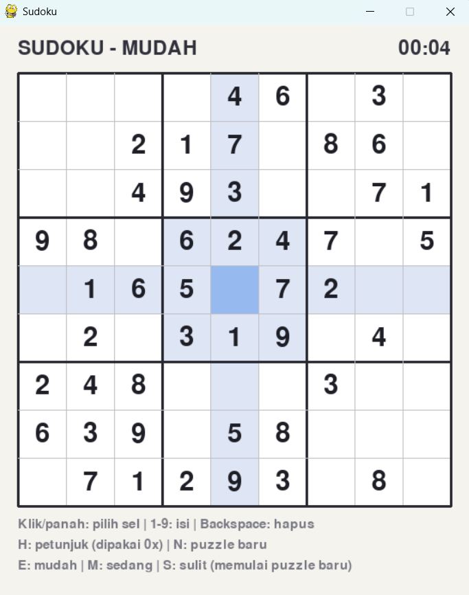

# Sudoku

## Deskripsi Proyek
Sudoku adalah permainan puzzle angka berbasis GUI yang dibangun menggunakan Pygame dengan pendekatan OOP (Object-Oriented Programming). Pemain mengisi grid 9x9 sehingga setiap baris, kolom, dan kotak 3x3 berisi angka 1 sampai 9 tanpa pengulangan. Puzzle dibuat secara acak setiap permainan baru dengan jaminan hanya memiliki satu solusi, dalam tiga tingkat kesulitan. Proyek ini menyelesaikan masalah membuat dan memainkan puzzle Sudoku secara lengkap di dalam satu aplikasi, termasuk generator puzzle, penyelesai otomatis, penanda bentrokan, dan petunjuk.

## Tampilan Aplikasi

## Fitur Utama
- Puzzle baru dihasilkan secara acak setiap permainan, dengan jaminan hanya memiliki satu solusi
- Tiga tingkat kesulitan: Mudah (36 sel kosong), Sedang (46 sel kosong), dan Sulit (52 sel kosong)
- Pemilihan sel dengan klik mouse atau tombol panah, pengisian angka dengan tombol 1 sampai 9, dan penghapusan dengan Backspace atau Delete
- Angka bawaan puzzle tidak dapat diubah dan ditampilkan dengan warna berbeda dari angka isian pemain
- Penanda bentrokan otomatis: angka yang bertabrakan di baris, kolom, atau kotak yang sama diberi latar merah muda dan angka merah
- Sorotan baris, kolom, dan kotak dari sel yang dipilih, serta sorotan seluruh angka yang sama dengan sel yang dipilih
- Fitur petunjuk (tombol H) yang mengisi sel terpilih dengan jawaban yang benar, disertai penghitung jumlah petunjuk yang dipakai
- Penghitung waktu bermain yang berhenti otomatis saat puzzle selesai
- Pesan penyelesaian saat seluruh sel terisi dengan benar
- Tombol N untuk puzzle baru, serta E, M, dan S untuk langsung memilih tingkat kesulitan

## Teknologi yang Digunakan
- Python 3.x
- Pygame
- Modul `random` dan `sys`

## Arsitektur
Proyek ini dipisah menjadi empat class dengan tanggung jawab yang jelas:
1. **`Penyelesai`** adalah penyelesai Sudoku berbasis backtracking dengan bitmask. Setiap baris, kolom, dan kotak menyimpan angka yang sudah terpakai sebagai bilangan bit, dan `_pilih_sel()` selalu memilih sel kosong dengan kandidat paling sedikit (heuristik MRV). Method `selesaikan()` menyelesaikan papan dan dapat mengacak urutan angka untuk menghasilkan solusi yang bervariasi, sedangkan `hitung_solusi()` menghitung jumlah solusi dan berhenti begitu mencapai batas.
2. **`GeneratorPuzzle`** membuat puzzle dalam dua tahap. `buat_solusi()` menghasilkan papan penuh yang valid dengan penyelesai berurutan acak, lalu `buat_puzzle()` mengosongkan sel satu per satu dan hanya mempertahankan pengosongan jika `hitung_solusi()` masih menghasilkan tepat satu solusi.
3. **`PapanSudoku`** menyimpan state puzzle: angka bawaan, isian pemain, dan solusi. Method `isi()` mengisi sel (menolak sel bawaan), `beri_petunjuk()` mengisi jawaban benar, `bentrok()` mendeteksi angka yang bertabrakan, dan `selesai()` memeriksa apakah papan penuh tanpa bentrokan.
4. **`GameSudoku`** mengatur tampilan dan input. Method `tangani_klik()` dan `tangani_tombol()` memproses input pemain, `_warna_sel()` menentukan warna latar setiap sel berdasarkan pilihan, sorotan, dan bentrokan, serta method `_gambar_*` menggambar grid, angka, informasi, dan pesan penyelesaian.

Alur permainannya: `main.py` membuat `GameSudoku` dan memanggil `jalankan()` → `mulai_baru()` membuat `PapanSudoku` yang memanggil `GeneratorPuzzle` → pemain memilih sel dan mengisi angka, dan setiap perubahan langsung diperiksa bentrokannya → saat seluruh sel terisi tanpa bentrokan, waktu dihentikan dan pesan penyelesaian ditampilkan.

## Pembelajaran Spesifik
- Menggunakan bitmask untuk merepresentasikan himpunan angka yang sudah terpakai, sehingga pencarian kandidat sebuah sel cukup berupa operasi bit (`~(baris | kolom | kotak) & 0x3FE`) yang jauh lebih cepat daripada membuat himpunan baru setiap kali.
- Menerapkan heuristik MRV (memilih sel dengan kandidat paling sedikit lebih dahulu) pada backtracking, yang memangkas ruang pencarian secara drastis dan membuat pembuatan puzzle selesai dalam hitungan milidetik.
- Menjamin keunikan solusi dengan menghitung jumlah solusi setiap kali sebuah sel dikosongkan, dan membatalkan pengosongan jika solusinya menjadi lebih dari satu.
- Menghentikan penghitungan solusi lebih awal begitu menemukan dua solusi (`batas=2`), karena untuk menguji keunikan cukup diketahui apakah solusinya satu atau lebih.
- Memisahkan state permainan (`PapanSudoku`) dari tampilan (`GameSudoku`), sehingga generator dan penyelesai dapat diuji sendiri tanpa menjalankan jendela Pygame.
- Menentukan warna sel dari beberapa kondisi yang bertingkat (pilihan, bentrokan, angka sama, sorotan baris/kolom/kotak), dengan urutan pengecekan yang menentukan kondisi mana yang lebih diutamakan secara visual.
