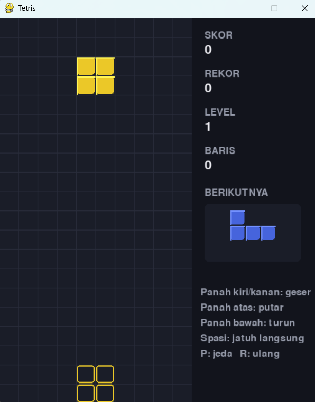

# Tetris

## Deskripsi Proyek
Tetris adalah replika permainan puzzle Tetris klasik berbasis GUI yang dibangun menggunakan Pygame dengan pendekatan OOP (Object-Oriented Programming). Pemain menyusun tujuh jenis balok yang jatuh pada papan 10x20 agar membentuk baris penuh yang kemudian terhapus, dengan kecepatan jatuh yang meningkat seiring naiknya level. Proyek ini menyelesaikan masalah mensimulasikan permainan arcade klasik secara lengkap, mulai dari deteksi tumbukan dan rotasi balok, sistem skor dan level, hingga tampilan bayangan balok dan pratinjau balok berikutnya.

## Tampilan Aplikasi

## Fitur Utama
- Tujuh jenis balok (I, O, T, S, Z, J, L) dengan warna berbeda
- Pemilihan balok memakai sistem kantong 7 balok (7-bag), sehingga setiap jenis balok muncul secara merata dan tidak ada balok yang terlalu lama tidak muncul
- Pergerakan kiri dan kanan, turun cepat, rotasi, serta jatuh langsung dengan tombol spasi
- Rotasi dengan pergeseran otomatis (wall kick sederhana) saat balok terhalang dinding atau balok lain
- Bayangan (ghost piece) yang menunjukkan tempat balok akan mendarat
- Panel pratinjau balok berikutnya
- Penghapusan baris penuh dengan skor bertingkat: 100, 300, 500, dan 800 poin untuk 1, 2, 3, dan 4 baris sekaligus, dikalikan level
- Poin tambahan untuk turun cepat dan jatuh langsung
- Level naik setiap 10 baris, dan kecepatan jatuh balok meningkat di setiap level
- Panel samping yang menampilkan skor, rekor selama sesi, level, dan jumlah baris
- Fitur jeda dengan tombol P dan mulai ulang dengan tombol R
- Rotasi dan jatuh langsung hanya diproses sekali per penekanan, tidak berulang saat tombol ditahan

## Teknologi yang Digunakan
- Python 3.x
- Pygame
- Modul `random` dan `sys`

## Arsitektur
Proyek ini dipisah menjadi tiga class dengan tanggung jawab yang jelas:
1. **`Balok`** merepresentasikan satu balok yang sedang jatuh, menyimpan bentuknya dalam bentuk matriks dan posisinya di papan. Method `sel_terisi()` menghasilkan koordinat setiap sel yang terisi, dan `matriks_rotasi()` menghasilkan matriks hasil rotasi 90 derajat searah jarum jam.
2. **`Papan`** mengelola grid 10x20 dan seluruh aturan tumbukan. Method `valid()` memeriksa apakah sebuah posisi berada di dalam papan dan tidak menimpa sel lain, `kunci()` memasukkan balok ke dalam grid, dan `hapus_baris_penuh()` menghapus seluruh baris yang penuh lalu menambahkan baris kosong di atas.
3. **`GameTetris`** mengatur seluruh alur permainan. Method `geser()`, `rotasi()`, `langkah_jatuh()`, dan `jatuh_langsung()` menangani pergerakan, `kunci_balok()` mengunci balok, menghitung skor dan level, lalu memunculkan balok berikutnya, `perbarui()` menjalankan gravitasi berdasarkan waktu yang berlalu, dan method `_gambar_*` menggambar papan, bayangan, panel samping, serta lapisan jeda atau game over.

Alur permainannya: `main.py` membuat `GameTetris` dan memanggil `jalankan()` → pada setiap frame, `tangani_event()` memproses input keyboard dan `perbarui()` menjatuhkan balok setiap interval waktu tertentu → saat balok tidak dapat turun lagi, `kunci_balok()` mengunci balok, menghapus baris penuh, memperbarui skor dan level, lalu memunculkan balok baru → jika balok baru langsung bertabrakan saat muncul, permainan berakhir.

## Pembelajaran Spesifik
- Merepresentasikan bentuk balok sebagai matriks dan melakukan rotasi dengan kombinasi `zip(*matriks[::-1])`, cara ringkas untuk memutar matriks 90 derajat tanpa menulis tabel rotasi untuk setiap balok.
- Menerapkan sistem kantong 7 balok dengan `random.shuffle()` agar distribusi balok adil, berbeda dengan pemilihan acak murni yang dapat memunculkan balok yang sama berulang kali.
- Menggunakan `pygame.key.set_repeat()` agar tombol arah dapat ditahan, sambil menyaring penekanan berulang pada tombol rotasi dan jatuh langsung dengan mencatat tombol yang sedang aktif, karena Pygame mengirim event `KEYDOWN` berulang untuk semua tombol.
- Menjalankan gravitasi berdasarkan waktu yang berlalu (`dt`) dan bukan jumlah frame, sehingga kecepatan jatuh balok tetap konsisten terlepas dari frame rate.
- Memisahkan pengecekan posisi (`Papan.valid()`) dari pergerakan, sehingga fungsi yang sama dapat dipakai untuk menggeser balok, memutar balok, dan menghitung posisi bayangan.
- Memanfaatkan lapisan transparan (`pygame.SRCALPHA`) untuk menampilkan tulisan jeda dan game over di atas papan tanpa menyembunyikan kondisi permainan sepenuhnya.
