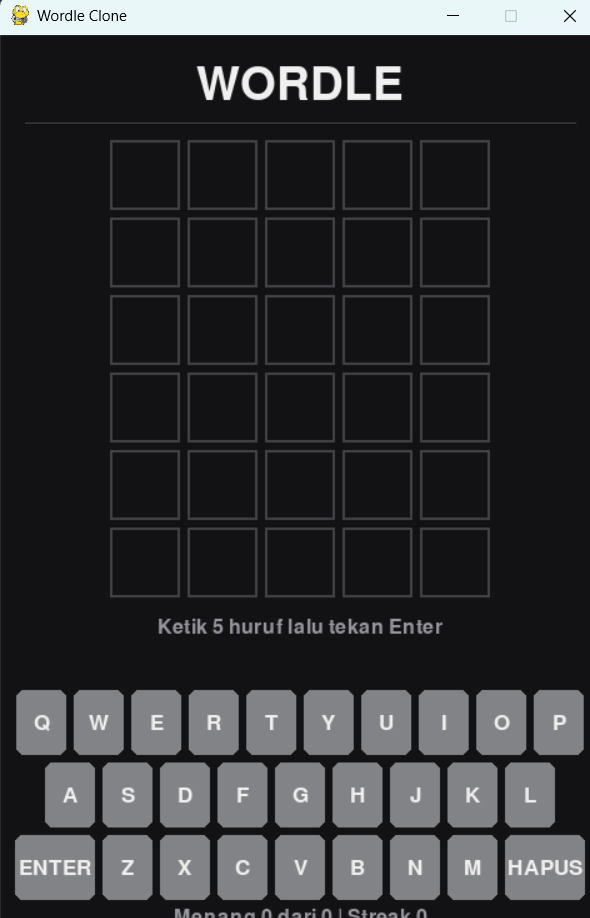

# Wordle Clone

## Deskripsi Proyek
Wordle Clone adalah permainan tebak kata berbasis GUI yang dibangun menggunakan Pygame dengan pendekatan OOP (Object-Oriented Programming), terinspirasi dari permainan Wordle. Pemain memiliki enam kesempatan untuk menebak sebuah kata Bahasa Indonesia sepanjang lima huruf, dan setiap tebakan diberi petunjuk warna pada setiap hurufnya. Proyek ini menyelesaikan masalah mensimulasikan permainan kata populer secara lengkap, termasuk aturan pewarnaan yang benar untuk huruf ganda, keyboard di layar yang ikut berwarna, serta statistik permainan selama sesi berlangsung.

## Tampilan Aplikasi

## Fitur Utama
- Kata jawaban dipilih secara acak dari daftar 180 kata Bahasa Indonesia sepanjang lima huruf
- Enam kesempatan menebak pada grid 6x5
- Petunjuk warna pada setiap huruf: hijau untuk huruf yang tepat posisinya, kuning untuk huruf yang ada pada kata tetapi salah posisi, dan abu-abu untuk huruf yang tidak ada
- Penanganan huruf ganda yang benar: jumlah huruf yang ditandai kuning tidak melebihi jumlah huruf tersebut pada kata jawaban
- Keyboard di layar yang warnanya ikut berubah sesuai status terbaik setiap huruf, dan dapat diklik dengan mouse
- Dukungan keyboard fisik (huruf, Enter, dan Backspace)
- Pesan peringatan dan efek getar pada baris saat tebakan belum lengkap lima huruf
- Pesan kemenangan, atau pengungkapan kata yang benar saat kalah
- Statistik sesi berupa jumlah kemenangan, jumlah permainan, dan streak kemenangan berturut-turut
- Tekan Enter setelah permainan selesai untuk langsung memulai permainan baru
- Tebakan tidak divalidasi terhadap kamus, sehingga kombinasi lima huruf apa pun diterima sebagai tebakan

## Teknologi yang Digunakan
- Python 3.x
- Pygame
- Modul `random`, `math`, `sys`, dan `collections`

## Arsitektur
Proyek ini dipisah menjadi satu fungsi dan dua class dengan tanggung jawab yang jelas:
1. **`evaluasi_tebakan()`** adalah fungsi murni yang menilai sebuah tebakan terhadap kata target dalam dua tahap. Tahap pertama menandai huruf yang tepat posisinya dan menghitung huruf target yang belum terpakai dengan `Counter`, lalu tahap kedua menandai huruf yang ada tetapi salah posisi, dibatasi oleh jumlah huruf yang masih tersisa.
2. **`PermainanWordle`** menyimpan seluruh state dan aturan permainan tanpa bergantung pada tampilan. Method `ketik()`, `hapus()`, dan `kirim()` memproses input, `status_huruf` melacak status terbaik setiap huruf untuk pewarnaan keyboard, dan kondisi permainan (`main`, `menang`, `kalah`) beserta statistik sesi dikelola di dalamnya.
3. **`GameWordle`** mengatur tampilan dan input. Method `_susun_keyboard()` menghitung posisi seluruh tombol di layar, `proses_kunci()` menyatukan input dari keyboard fisik dan klik mouse ke satu jalur yang sama, serta method `_gambar_*` menggambar grid, keyboard, pesan, dan statistik.

Alur permainannya: `main.py` membuat `GameWordle` dan memanggil `jalankan()` → pemain mengetik huruf (lewat keyboard fisik atau klik tombol di layar) dan menekan Enter → `PermainanWordle.kirim()` memanggil `evaluasi_tebakan()`, menyimpan hasil, dan memperbarui warna keyboard → permainan berakhir saat tebakan tepat atau enam kesempatan habis, lalu Enter memulai kata baru.

## Pembelajaran Spesifik
- Menerapkan aturan huruf ganda Wordle dengan algoritma dua tahap, karena penandaan satu tahap akan salah menandai huruf kuning secara berlebihan ketika sebuah huruf muncul lebih dari sekali pada tebakan.
- Menyatukan input keyboard fisik dan klik keyboard di layar ke fungsi `proses_kunci()` yang sama, sehingga logika permainan tidak perlu menulis dua jalur yang berbeda untuk sumber input yang berbeda.
- Menyimpan status huruf dengan sistem prioritas (`benar` lebih tinggi dari `ada`, lebih tinggi dari `salah`), sehingga warna keyboard tidak pernah turun ke status yang lebih rendah setelah sebuah huruf sudah terbukti benar.
- Membuat efek getar pada baris aktif menggunakan fungsi `sin()` yang dihitung dari waktu berjalan, tanpa perlu menyimpan state animasi tambahan.
- Mengatur tata letak vertikal (grid, pesan, keyboard, statistik) lewat konstanta posisi, dan memverifikasinya lewat tangkapan layar karena elemen yang saling menimpa tidak tampak saat hanya menguji logika permainan.
- Memisahkan fungsi evaluasi murni dari class permainan, sehingga aturan pewarnaan dapat diuji dengan kasus-kasus huruf ganda tanpa membuka jendela Pygame.
